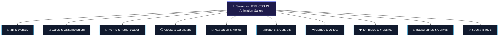

<p align="center">
  <a href="https://suleimanhtmlcssjsanimationgallery.github.io/">
    
  </a>
</p>

<p align="center">
  <strong>57+ Production-Ready Creative Web Animations, 3D CSS Perspectives & Modern UI Components</strong><br>
  <em>Müasir Veb Animasiyaları, 3D CSS Transformasiyaları, Glassmorphism Dizayn Komponentləri və İnteraktiv Veb Şablonları Mərkəzi</em>
</p>

<p align="center">
  <a href="https://suleimanhtmlcssjsanimationgallery.github.io/"></a>
  <a href="https://github.com/SuleimanHTMLCSSJSanimationgallery/SuleimanHTMLCSSJSanimationgallery"></a>
  <a href="https://suleimanhtmlcssjsanimationgallery.github.io/"></a>
  
  <a href="mailto:suleyman.hacizade1@gmail.com"></a>
</p>

---

## 🏛️ Müəllif və Təşkilat Rəhbərliyi / Leadership & Authorship

* **Təsisçi və Layihə Rəhbəri:** **Süleyman Hacızadə** ([@SuleimanHajizadeh](https://github.com/SuleimanHajizadeh))
* **Təhsil Müəssisəsi:** **Qərbi Kaspi Universiteti** (*Western Caspian University*), Bakı, Azərbaycan
* **İxtisas İstiqaməti:** *Frontend Development, Bioinformatika və Kompüter Elmləri*
* **Rəsmi Əlaqə:** `suleyman.hacizade1@gmail.com`
* **Şəxsi GitHub Portfeli:** [github.com/SuleimanHajizadeh](https://github.com/SuleimanHajizadeh)

---

## 🌟 Təşkilatın Missiyası (Organization Mission)

**SuleimanHTMLCSSJSanimationgallery** — müasir veb proqramlaşdırmanın fundamental əsasları (Vanilla Web Technologies: **HTML5, CSS3 və təmiz JavaScript**) üzərində qurulmuş, heç bir xarici asılılıq və ya ağır freymvork tələb etməyən 57-dən çox yaradıcı dizayn, mikro-qarşılıqlı əlaqə (micro-interaction) və animasiya həllərini bir araya gətirən mərkəzləşdirilmiş açıq mənbəli təşkilatdır.

### Fəlsəfəmiz:
1. **Zero-Dependency Vanilla Purity:** Hər bir layihə xam veb standartlarına əsaslanır; node paketləri və ya mürəkkəb derləmə mərhələləri olmadan istənilən brauzerdə dərhal işə düşür.
2. **GPU-Accelerated Smooth Motion:** `transform: translate3d/rotate3d`, `perspective`, və hardware-accelerated CSS keyframe animasiyalarından istifadə ilə 60 FPS axıcılıq təmin edilir.
3. **Glassmorphism & Modern Aesthetic:** Real-vaxtlı `backdrop-filter: blur()`, neon işıq saçmaları, dinamik qradiyent çərçivələr və dərinlikli kölgə sistemləri.
4. **Interactive In-Browser Sandbox:** Bütün 57 layihə rəsmi veb portalda həm birbaşa modal daxilində (iframe sandbox), həm də Netlify üzərində canlı sınaqdan keçirilə bilər.

---

## 🗂️ Rəsmi Repozitoriyalar / Official Repositories

| Repozitoriya | Növü | Təsvir və Əhəmiyyəti | Keçid |
| :--- | :---: | :--- | :---: |
| 🌐 **[SuleimanHTMLCSSJSanimationgallery.github.io](https://github.com/SuleimanHTMLCSSJSanimationgallery/SuleimanHTMLCSSJSanimationgallery.github.io)** | `Public` 🌍 | **Rəsmi İnteraktiv Veb Portal & Canlı Sərgi:** 57 layihənin ani axtarışı (`/` qısayolu ilə), 10 kateqoriya filtri, daxili modal sandbox önbaxışı, qaranlıq/işıqlı mövzu dəyişdirici və responsiv interfeys. | [🔗 Canlı Portal](https://suleimanhtmlcssjsanimationgallery.github.io/) |
| 🔒 **[SuleimanHTMLCSSJSanimationgallery](https://github.com/SuleimanHTMLCSSJSanimationgallery/SuleimanHTMLCSSJSanimationgallery)** | `Private` 🔐 | **Əsas Kod Bazası & Resurs Mərkəzi:** Bütün 57 animasiya modulunun tam mənbə kodları, aktivləri, Developer Hazırlığı kurikulumları, qrafik resursları və layihə arxivi. | [📦 Kod Bazası](https://github.com/SuleimanHTMLCSSJSanimationgallery/SuleimanHTMLCSSJSanimationgallery) |
| ⚙️ **[.github](https://github.com/SuleimanHTMLCSSJSanimationgallery/.github)** | `Public` 🌍 | **Təşkilat Profili & Qlobal Standartlar:** Təşkilatın əsas səhifə dizaynı, brend aktivləri, arxitektura sənədləri və icma təlimatları. | [⚙️ Profil](https://github.com/SuleimanHTMLCSSJSanimationgallery/.github) |

---

## 🎨 Layihə Kateqoriyaları və İnteraktiv Vitrin (57 Demos)



### 1. 🧊 3D & WebGL / Spatial Perspectives
* **3D Animation Hover Effects:** Kartların və elementlərin kursor koordinatlarına görə 3D məkan fırlanması (`transform: perspective() rotateX() rotateY()`).
* **Isometric Menu Hover Effects (3D Menu):** İzometrik bucaqda (`rotateX(60deg) rotateZ(-45deg)`) laylaşan və hover zamanı pilləli yüksələn 3D naviqasiya strukturu.
* **3D Real Glassmorphism Testimonials Card:** Dərinlikli şüşə effekti və optik refraksiya ilə hazırlanan rəy kartları.

### 2. 💎 Cards & Glassmorphism
* **Product Card Hover Effect (Coca-Cola 3D Tilt):** Məhsul qutusunun kartdan kənara çıxması ilə müşayiət olunan interaktiv e-ticarət kartı.
* **CSS Glowing Gradient Cards:** Neon kənar qradiyentinin fırlanması ilə animasiya olunan zərif kartlar (`conic-gradient`).
* **Animated Profile Card & Service Sections:** Sosial şəbəkə ikonlarının hamar açılışı və xidmət təqdimat kartları.

### 3. 🔐 Forms & Authentication
* **Animated Glassmorphism Parallax Login Form:** Fon, dağlar, ay və yol elementlərinin kursor hərəkətinə görə parallaks dərinlik yaratdığı premium giriş səhifəsi.
* **Animated Login & Registration Flip Form:** Daxilolma və qeydiyyat panellərinin 3D çevrilməsi (flip animation) ilə keçid edən forma.
* **Floating Labels & Modern Neumorphic Logins:** Dinamik fokuslanma və qüsursuz daxiletmə sahələri.

### 4. ⏱️ Clocks, Timers & Calendars
* **Animated Working Analog Clock:** JavaScript vaxt mühərriki ilə real vaxtı saniyəbəsaniyə göstərən, fırlanan əqrəbli zərif saat.
* **Digital Clock & Lap Stopwatch:** Yüksək dəqiqlikli millisaniyə qeydləri aparan saniyəölçən və rəqəmsal tarix/saat panelləri.
* **Dynamic & Mini Interactive Calendars:** Ayları dəyişmə, günləri seçmə və cari tarixi vurğulayan interaktiv təqvimlər.

### 5. 🧭 Navigation & Interactive Menus
* **Animated Navigation Menu Indicator:** Aktiv menyu bəndinə hamar sürüşərək keçən və formanı dəyişən SVG göstərici (indicator).
* **Animated Tab Bar Navigation:** Mobil tətbiq estetikasında hazırlanmış alt menyu keçidləri.
* **Creative Menu & List Hover Designs:** Kursor yaxınlaşdıqda yaradıcı şəkildə böyüyən və rəng qradiyentləri ilə canlanan bəndlər.

### 6. 🔘 Buttons, Toggles & Interactive Controls
* **3D Glowing Checkbox Buttons:** Seçildikdə neon mavi və çəhrayı işıq saçan fərdi checkbox elementləri.
* **Colorful Button Ripple Effects:** Kliklənən nöqtədən xaricə doğru yayılan Material Design dalğa effekti (`radial ripple`).
* **Switch On/Off Light Bulb with Sound:** Real lampanın yanması, otağın qaranlıqlaşması və audio səs effekti ilə inteqrasiya olunmuş açar.
* **Interactive Star Rating:** İstifadəçi məmnuniyyətini dərəcələndirən interaktiv ulduz animasiyası.

### 7. 🎮 Games & Productivity Utilities
* **Tic-Tac-Toe Game:** 2 oyunçulu və alqoritmik qaydalarla işləyən interaktiv "X vs O" oyunu.
* **Neumorphic Calculator:** Bütün riyazi əməliyyatları dəstəkləyən yumşaq kölgəli (`neumorphism`) kalkulyator.
* **To-Do List & Task Manager:** Brauzerin `localStorage` yaddaşı ilə sinxronlaşan, filtrlənə bilən tapşırıq idarəçisi.
* **Get User Location Utility:** HTML5 Geolocation API vasitəsilə enlik, uzunluq və dəqiqlik koordinatlarını tapan skript.

### 8. 🌐 Modern Templates, Landings & Portfolios
* **Animated Gaming Website:** Tünd qaranlıq kiber-estetikada hazırlanmış interaktiv oyun portalı şablonu.
* **Parallax Scrolling with ScrollTrigger:** Səhifəni sürüşdürdükcə hərəkət edən qrafik laylar və hekayə axını.
* **Fullscreen Website Slider:** Böyük vizual bannerləri hamar keçidlə təqdim edən tam ekranlı slayd sistemi.
* **Barak Obama Tribute & Personal Portfolios:** Tipoplastik zəriflik və məzmun təqdimatı.

### 9. 🌌 Dynamic Canvas & Backgrounds
* **Glass Ball Particle Physics:** HTML5 Canvas üzərində cazibə qüvvəsi və toqquşma fizikasını canlandıran şüşə zərrəcikləri.
* **Animated Backgrounds:** Hipnotik qradiyent dalğaları və arxa plan işıqlandırmaları.

### 10. ✨ Creative Special Effects
* **Police vs Taxi Running Car Animation:** CSS keyframe animasiyaları ilə hərəkət edən avtomobillər və dinamik küçə səhnəsi.
* **Happy Holi & New Year Celebrations:** Rəng partlayışları və bayram atəşfəşanlığı vizual effektləri.
* **Glowing Line & Wave Typography:** Neon konturlu xətlər və mətnlərin hərflər üzrə dalğalanması.

---

## 💻 Texnologiya Qatı (Tech Stack)

```
Frontend Core    : HTML5 Semantic Elements, CSS3 Custom Properties, Modern JavaScript (ES6+)
Motion Engine    : CSS @keyframes, CSS 3D Transforms, Web Animations API, Canvas 2D
Design System    : Glassmorphism (backdrop-filter), CSS Grid, Flexbox, Fluid Typography (clamp)
Testing & Live   : Netlify CDN, GitHub Pages (Custom Domain Ready, HTTPS Enforced)
Branding Assets  : Scalable Vector Graphics (SVG), Web App Manifest (PWA compliant)
```

---

## 🔗 Ekosistem Keçidləri

* 🌐 **Rəsmi Veb Portal:** [https://suleimanhtmlcssjsanimationgallery.github.io/](https://suleimanhtmlcssjsanimationgallery.github.io/)
* 📂 **Əsas Kod Reposu:** [SuleimanHTMLCSSJSanimationgallery/SuleimanHTMLCSSJSanimationgallery](https://github.com/SuleimanHTMLCSSJSanimationgallery/SuleimanHTMLCSSJSanimationgallery)
* 🏢 **GitHub Təşkilat Səhifəsi:** [https://github.com/SuleimanHTMLCSSJSanimationgallery](https://github.com/SuleimanHTMLCSSJSanimationgallery)
* 👤 **Təsisçinin Şəxsi Profili:** [Suleiman Hajizadeh](https://github.com/SuleimanHajizadeh)

---

<p align="center">
  <sub>© 2026 SuleimanHTMLCSSJSanimationgallery. Western Caspian University • Baku, Azerbaijan. Bütün hüquqlar qorunur.</sub>
</p>
